# 内镜场景的重光照新样本生成与数据集构建 — 项目总结

> 这是一份**内容总结**，不是逐字讲稿。每一节对应演示里的一块内容，需要讲的话按这个顺序展开即可。
> 幻灯片级的排版建议见 [`幻灯片大纲.md`](幻灯片大纲.md)，演示用图在 [`figures/`](figures/)。
> 所有数字的出处集中在 [`data/key_numbers.json`](data/key_numbers.json)，图由 [`scripts/`](scripts/) 里的脚本从原始运行结果重新生成。

---

## 0. 一句话概括

我们要解决的是**内镜数据稀缺**：真实内镜视频里光源跟着相机走、视角受限、不可能为同一段肠道重拍不同光照。
我们比较了两条生成新样本的路线——**图形学渲染**和**可重光照高斯泼溅**——并且用第一条路线产出的物理真值，
对第二条路线（PR-ENDO）做了**定量的重光照评估**。评估暴露出一个具体缺陷，我们定位到了它的根因（一行 CUDA 代码），
改掉并重训后 PSNR 提升 **+8.0 dB**，同时也确认了两个**改不掉**的剩余局限。

---

## 1. 问题背景

内镜（结肠镜、胶囊内镜）图像有三个和普通场景完全不同的性质：

1. **光源与相机绑定。** 内镜的照明就装在镜头旁边，光源随相机一起移动。这意味着画面里的亮度变化同时
   编码了几何、材质和运动，很难分开。
2. **相机轨迹受限。** 镜子在肠腔里只能大致沿管腔前进，很难绕着一块黏膜转一圈。可用的视角方向非常窄。
3. **没有可控的重复实验。** 同一段肠道不可能在不同光照下再拍一遍，所以**不存在天然的重光照真值**。

下游任务（深度估计、息肉检测、SLAM、手术仿真）都需要大量带标注、带光照多样性的数据，而上面三点
决定了这些数据只能**生成**出来。

---

## 2. 两条生成路线

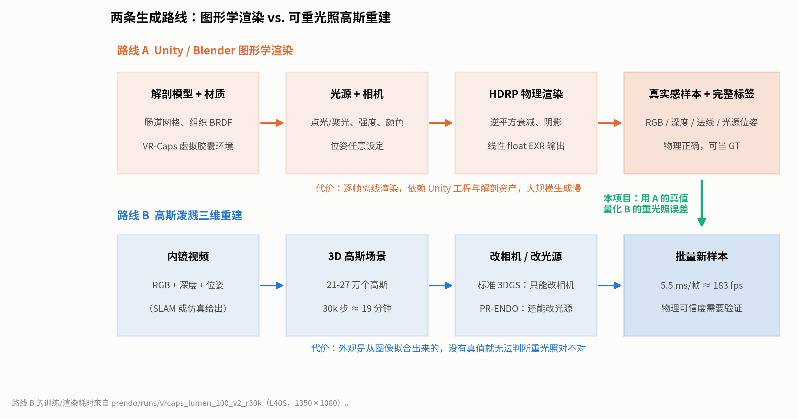

### 路线 A：Unity / Blender 等图形学渲染

在 3D 建模与渲染引擎里，解剖网格、组织材质、光源参数、相机位姿都是可以随意设定的自由变量，
渲染管线本身实现了物理上正确的光传输（逆平方衰减、聚光锥、阴影、BRDF）。

- **优点**：样本物理正确，而且**标签是免费的**——深度、法线、反照率、光源位姿、分割掩码都可以直接导出；
  可以任意组合光照条件，想要多少种就有多少种。
- **缺点**：逐帧离线渲染，成本随样本数线性增长；而且强依赖一套高质量的解剖资产与 Unity/Blender 工程，
  换一个病人、换一段真实解剖结构就要重新建模。规模化生成效率低。

本项目里这条路线由 **VR-Caps**（基于 Unity HDRP 的虚拟胶囊内镜环境）承担。

### 路线 B：高斯泼溅三维重建

把一段内镜视频重建成一个 3D 高斯场景，之后改相机位姿就能批量渲染新视角。

- **优点**：重建一次 ≈ 19 分钟（30k 步，单张 L40S），之后渲染 **5.46 ms/帧 ≈ 183 fps**（1350×1080）。
  批量生成的边际成本几乎为零，而且**可以直接重建真实病人的视频**，不需要建模师。
- **缺点**：见下一节——这正是我们要核实的地方。

**关键点：两条路线不是二选一。** 本项目的做法是用路线 A 产出物理真值，去**量化**路线 B 的物理可信度。
没有 A，B 的重光照结果就只能"看起来像"，无法证伪。

---

## 3. 需要讲清楚的三个技术问题

### 3.1 "高斯重建不真实"——这个说法需要修正

**不准确。** 标准 3DGS 在训练轨迹附近的新视角合成是**照片级真实**的，这是它的强项，不是弱点。
在 C3VD 上原版 3DGS 的 PSNR 是 33.90 dB，PR-ENDO 是 34.24 dB——两者的重建图像肉眼几乎分不出来。
我们自己的 VR-Caps 数据上，修复后的模型 L0 重建达到 **42.5 dB**。

真正的局限不在"像不像"，而在**它表示的是什么**：

| 说法 | 对不对 | 准确的表述 |
|---|---|---|
| 高斯重建画面不真实 | ✗ | 在训练轨迹附近，它的插值画面是照片级的 |
| 高斯重建是物理模型 | ✗ | 它是**外观拟合**：每个高斯存的是"从某个方向看过去是什么颜色" |
| 高斯重建能改光照 | ✗ | **光照被烤进了颜色里**（baked-in），改不了 |
| 高斯重建在大幅度外推下会崩 | ✓ | 训练轨迹外会出现飘浮物（floaters）、脱色碎片 |

PR-ENDO 论文 fig.4 的原话就是：3DGS 和 GaussianPancakes *"bake light-dependent effects into textures"*。
在内镜这个"光源跟着相机走"的场景里这个问题被放大了——模型完全有可能把"离相机近所以亮"学成
"这块组织本来就是亮的"，于是一旦光源单独移动，画面就全错。

**所以正确的叙述是：标准 3DGS 能做"新视角"，不能做"新光照"。**

### 3.2 PR-ENDO 的创新

PR-ENDO（Kaleta et al., arXiv:2411.12510，Sano Science / Jagiellonian）把 3DGS 换成一个
**基于物理的可重光照模型**：

1. **利用内镜特有的先验**：单一光源与相机共位。所以光源模型可以直接挂在相机位姿上，而且这个
   微小的偏移量还可以一起优化。
2. **每个高斯带上材质参数**：基础色 `a`、粗糙度 `r`、基础反射率 `F0`；高光用 Cook-Torrance GGX
   微表面模型（D 用 Trowbridge-Reitz，F 用 Schlick，G 用 Schlick-Beckmann）。
3. **diffuseMLP**——核心创新。漫反射不再用纯解析公式，而是
   `f_diffuseMLP,i = θ(l_i, d_i, n_i) · a_i / π`，输入是光照方向、光源距离、高斯法线，训练时对输入加
   小噪声。这一项才是在"相机轨迹极度受限"的内镜数据上还能泛化的原因。
4. **两个新损失**：`L_Diffuse` 把 MLP 的辐照度拉回经典点光源光传输方程；`L_Tissue` 正则化
   albedo/roughness/F0，防止光照效果渗进基础色。
5. **最终着色**：`RGB = I · att(d) · (f_diffuseMLP·(1−F) + f_specular) · (n·l)`，
   其中衰减 `att(d) = 1 / (1 + k·d^p)`，`I`、`k`、`p` 都是可学习参数。

**它解决了什么**：光照和组织被分开了。训练完之后可以移动光源、改强度、改颜色、把点光换成聚光，
甚至在形变组织上保持物理一致的光响应——这是标准 3DGS 做不到的。

**基准成绩**（论文表 1）：

| 方法 | C3VD PSNR | RotateColon PSNR |
|---|---:|---:|
| 3DGS | 33.90 | 20.29 |
| GaussianPancakes | 33.12 | 20.10 |
| GaussianShader | 29.82 | 21.25 |
| 3DGS-DR | 33.77 | 21.49 |
| **PR-ENDO** | **34.24** | **21.90** |

### 3.3 作者自己承认的缺陷

论文 Limitations 一节原文：

> "PR-ENDO offers fast optimization and rendering. However, training time is ∼2× longer than for
> vanilla 3DGS. Our model improves generalization to novel viewpoints and geometries compared to
> existing methods but still faces challenges with **very distant light sources, extreme camera
> rotations and extreme body deformations**. For highly textured tissues, a more complex L_Tissue
> may be required."

还有一个作者没写进 Limitations、但同样重要的事实：

> **论文里没有任何重光照的定量基准。** 因为 C3VD 和 RotateColon 都没有"同一帧在不同光照下"的真值，
> 所以重光照只能定性展示（fig. 3–5 和补充视频）。换句话说，**"PR-ENDO 的重光照在物理上有多准"
> 这个问题，论文没有回答。**

这个空白正是我们工作的切入点。

---

## 4. 我们做了什么

### 4.1 用 VR-Caps 造一个有重光照真值的数据集

分工上，VR-Caps 组员负责在 Unity HDRP 里渲染，PR-ENDO 组员负责训练与生成，第三位组员负责比较。
数据流向见 [`../handoff/数据流向.md`](../handoff/数据流向.md)。

**训练基线 `VRCaps_lumen_100_v2`**（这是后面所有实验的共同基础）：

| 项目 | 设定 |
|---|---|
| 分辨率 / 帧数 | 1350 × 1080，100 帧（88 训练 / 12 留出），5 秒 20 fps 轨迹均匀采样 |
| 光源 | 单个白色 HDRP Point，**严格放在相机光心**，偏移 (0,0,0) |
| 强度 / 曝光 | 50,000 cd；固定 EV100 = 20，无补偿 |
| 衰减 | 逆平方；关闭 smooth range falloff |
| 关掉的东西 | 阴影、天空/环境光、间接漫反射与镜面、lightmap、反射探针、SSR、SSAO、tone mapping、所有后处理 |
| 编码 | `round(255 · clamp(linear_RGB,0,1)^(1/2.2))`，RGB8 PNG；不做第二次 gamma |
| 过曝 | 每帧有效组织像素的过曝比例 < 0.12% |
| 工作距离 | 有效训练深度中位数 `d_ref` = 0.336 世界单位 |

**把环境项全部关掉是刻意的**：这样 Unity 的成像就是一个干净的"单点光源 + BRDF"问题，
和 PR-ENDO 的物理假设一一对应，比较才有意义。

**25 个重光照配置**，分成 6 个层级（难度递增）：

| 层级 | 改什么 | 配置数 |
|---|---|---:|
| **L0** | 什么都不改 → 这是**纯重建上限**，用来把重建误差和重光照误差分开 | 1 |
| **L1** | 光源强度 ×0.5 / ×2 | 2 |
| **L2** | 点光换成聚光，**光束方向**转 yaw / pitch | 9（最终协议用 7 个） |
| **L3** | 光源**离开相机光心**，沿相机右/上/前方向平移 d_ref 的倍数 | 8 |
| **L4** | 光源颜色 → 红 / 绿 / 蓝 | 3 |
| **L5** | 光源**固定在世界坐标**，相机继续移动 | 2 |

L0 这一层是整个评估设计的关键：**L1–L5 的误差 = 重建误差 + 重光照误差**，而 L0 只有重建误差。
两者相减才能回答"错在重建还是错在光照模型"。

最终协议：**611 条 (配置, 帧)**，803 个 GT variant 比较，0 缺失。

### 4.2 训练与基线结果

在 Imperial CX3（L40S）上按论文默认超参训练 30k 步，耗时 1131 秒，峰值显存 9.18 GB，
得到 213,091 个高斯，**留出帧 PSNR 33.64 dB**。

从"PR-ENDO 能不能迁移到 VR-Caps 数据"这个问题看，**答案是肯定的**：

- 训练稳定收敛，没有发散、没有塌缩；
- L2 重光照（点光→4× 聚光，7 个方向）平均 **32.99 dB**，比"完全不重光照直接用 L0 渲染"高 **+11.6 dB**；
- 7 个方向的**方向一致性检查 100% 通过**，ratio_corr 0.99–1.00，ratio_bias −1.4%
  ——也就是说，光束往右转，模型渲染出来的亮区也确实往右移，而且量级是对的。

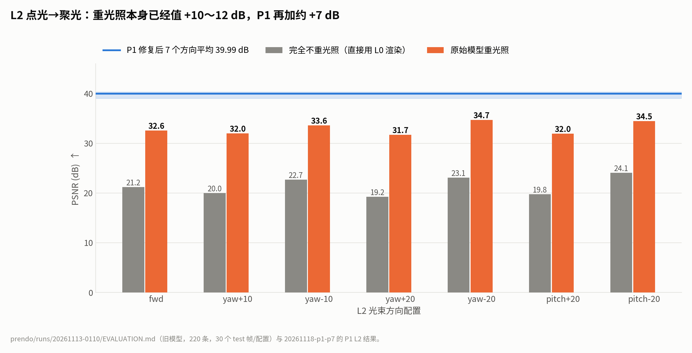

**顺带回答一个设计上的疑问**：7 个 L2 方向的分数差别很大（31.7 到 34.7 dB），这不是模型建模错了方向，
而是**不同方向的光照改变量本身就不一样**。在 GT 上算归一化亮度比 `R = (L2/L0)/4`：yaw+20 的
mean R = 0.75（可见墙面接收了大量额外光），yaw−20 只有 0.31（大部分光射进暗腔）。
改变越大的配置越难，PSNR 自然越低。见 [`figures/fig07_L2_direction_effect_maps.png`](figures/fig07_L2_direction_effect_maps.png)。

### 4.3 但是有一个明显的问题

L3（光源离开相机光心）的分数掉得很厉害，近壁区域尤其糟糕：**L3 近壁只有 21.5 dB，远区 35.2 dB**，
差了近 14 dB。肉眼看就是近处的肠壁糊成一片橘红色，没有组织纹理。

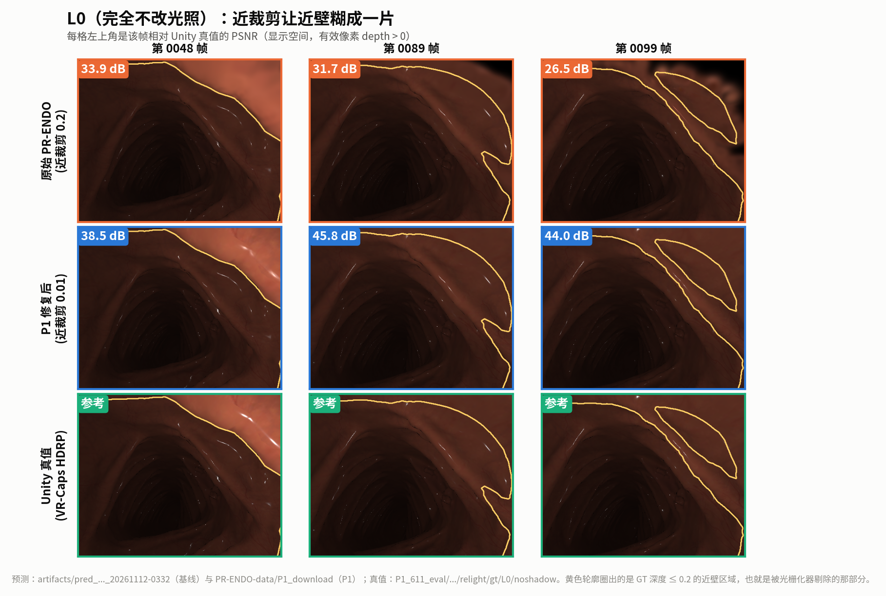

> **术语澄清**：这里出问题的是 **L3（移动光源位置）**，不是 L2（转光束方向）。
> 讲的时候不要说成"调整相机位置"——相机位姿在重光照评估里是**固定**的，变的只有光源。
> 高光渲染不准是另一个独立发现（见 5.4），两件事不要混为一谈。

---

## 5. 归因：32 项实验找根因

面对"近壁坏掉"这个现象，我们列了 **23 个候选原因**，设计了 **32 项实验**（A01–A17 用图像与真值，
B01–B15 用模型权重与官方源码）。完整清单见
[`../../PR-ENDO/docling_PR-ENDO 重光照：实验清单与原因评估.md`](../../PR-ENDO/docling_PR-ENDO%20重光照：实验清单与原因评估.md)。

结果：**3 个已证实，3 个有支持证据，13 个被排除，4 个待检验。**

被排除的 13 项值得一提，因为它们是结论可信的前提：指标算错（A01，重算差异 0.0000 dB）、
光源坐标或方向错（A02，位置误差 < 1e-6，光轴 ≤ 0.04°）、真值不符合物理（A03，拟合距离幂次 1.99–2.02）、
颜色/伽马流程不一致（A04）、聚光指数标定不准（A06）、高光过曝截断（A12，过曝 0.12%）、
阴影（A17，前移配置阴影只占 0.07% 面积）、法线错误（B11，中位误差 4°）、观测次数不够（A14/B07）……
**都排除了。**

### 5.1 根因：光栅化器里硬编码的近裁剪

`submodules/depth-diff-gaussian-rasterization/cuda_rasterizer/auxiliary.h:154`：

```cpp
if (p_view.z <= 0.2f)   // 直接剔除，与 znear = 0.01 无关
```

这是 3DGS 原版光栅化器就带着的一行，对普通室外场景无害。但在我们的内镜场景里：

- 工作距离中位数只有 0.336 世界单位，**0.2 相当于 0.595 倍工作距离**；
- 画面里 **17.4% 的像素**落在这个距离内；
- 这些像素贡献了 **L0 平方误差的 79%**（序列后半段 94%）、**L3 的 61–92%**。

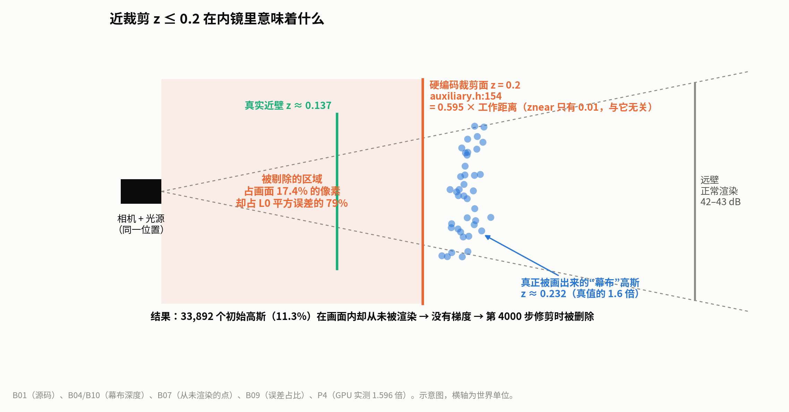

**证据链**（每一环都是独立实验）：

| 问题 | 实验 | 结果 |
|---|---|---|
| 源码真的剔除吗 | B01 | `auxiliary.h:154` 硬编码；训练环境确实从该子模块安装 |
| 近壁上还有高斯点吗 | B04 | 近壁像素里位于真实表面 ±2% 的只有 0–4%（远处 89–94%） |
| 那画面是谁画的 | B10 | 100% 的权重来自 z < 0.25 的"幕布"高斯；绘制深度中位 0.232，真值 0.137 |
| 点什么时候消失的 | B05 | 第 10 帧近壁点：28,660 → 18，发生在第 1000–10000 步之间 |
| 哪条规则删的 | B06 | 近壁点不透明度中位数仍是初值 0.100（其他位置 0.304）→ **从未收到梯度** |
| 误差是否在 z=0.2 跃变 | B08 | 是，0.2 以外各档 40–43 dB，0.19–0.20 档 34.6 dB，更近 21.8–31.1 dB |

**机制**：近壁的高斯点从来没被渲染过 → 没有梯度 → 不透明度停在初始值 →
每 3000 步的 opacity reset 把它压到 0.01 → 下一次 prune（阈值 0.05）把它们全删了 →
近壁从此由后方 2 倍远处的一层"幕布"高斯代画。

**这是一个"配置/工程"缺陷，不是方法缺陷。** 把这两者分开，是整个归因工作最有价值的结论。

### 5.2 验证：P5 复现删除时间点

重训一次，每 1000 步存点云并记录每次 prune 删了哪些点：

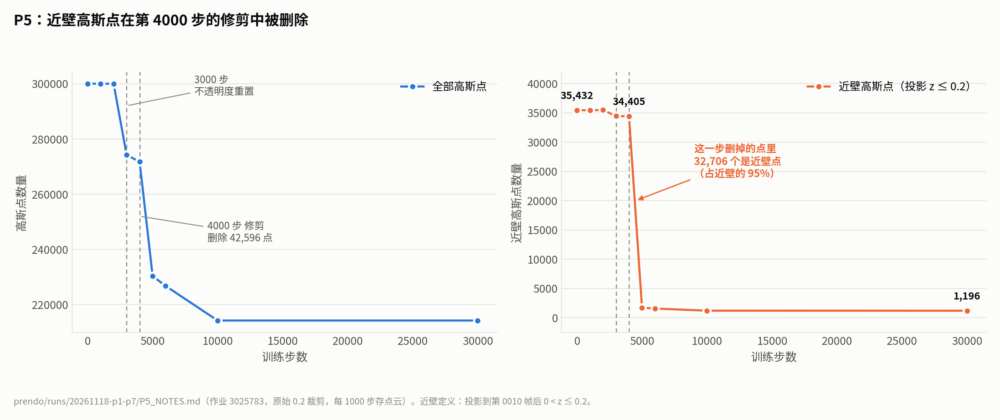

第 3000 步的 opacity reset 触及 271,744 个点但不删；**第 4000 步的 prune 删掉 42,596 个点，
其中 32,706 个是近壁点**——占近壁的 95%。之后残余约 1.2k 并一直稳定到 30k 步。
预测的机制和时间点完全吻合。

### 5.3 修复：P1 把阈值改成 0.01 并重训

把 `0.2f` 改成 `0.01f`，用隔离的补丁光栅化器重新编译，其余超参一字不改，重训 30k 步：

| | 原始 | P1 修复后 | 变化 |
|---|---:|---:|---:|
| 留出帧 PSNR | 33.64 | **41.68** | **+8.04 dB** |
| 高斯点数 | 213,091 | 270,724 | +57,633（近壁点活下来了） |

611 条完整重光照评估，**每一个层级都提升**：

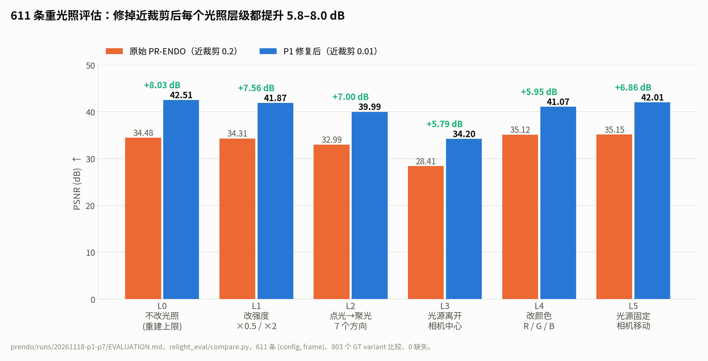

近壁与远区的差距被抹平：

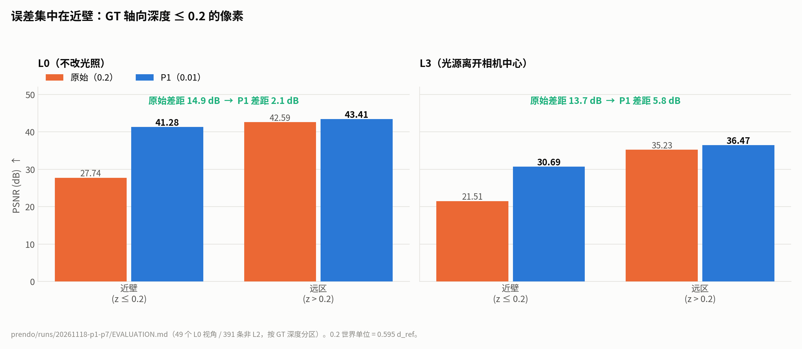

我们另外做了一次**独立复算**——直接从真值 EXR、基线预测与 P1 预测出发，按 GT 深度分档统计 L0 PSNR
（不引用任何汇总表）：

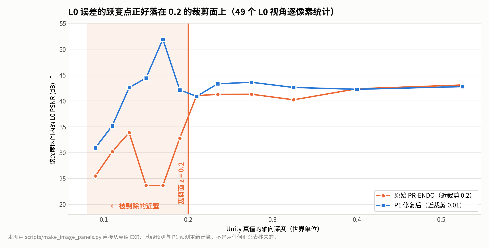

跃变点**精确落在 0.2** 上。深度大于 0.2 的所有档位，原始模型和 P1 几乎一样（40–43 dB）；
深度小于 0.2 的档位，原始模型掉到 23–34 dB，P1 保持 31–52 dB。
这是一张能单独支撑整个结论的图。

误差图把同一件事画了出来：

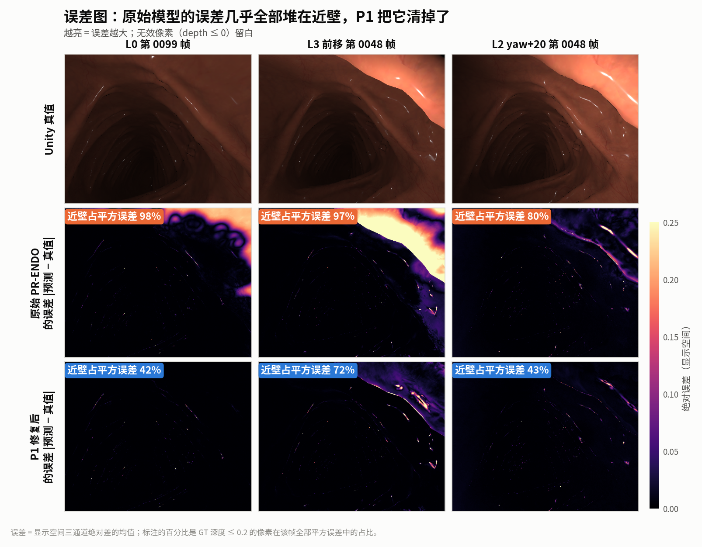

**P4 的 GPU 直接证据**：对 49 个视角渲染深度图，近壁的"渲染深度 / 真值深度"中位比
从 **1.596 降到 0.985**。

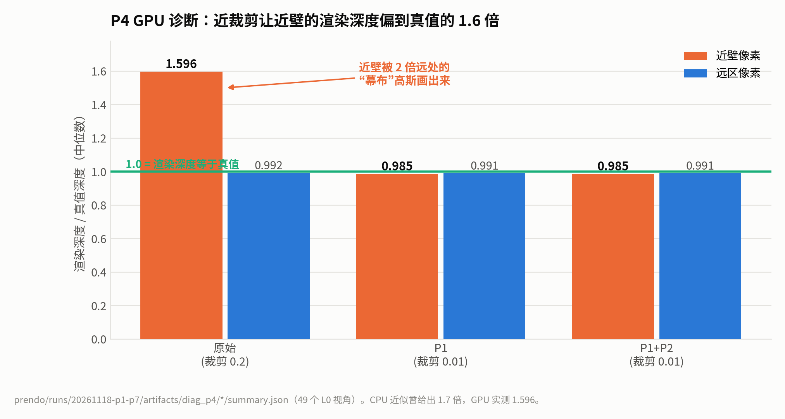

### 5.4 P1 没能解决的两件事

这是这份工作最诚实、也最有讲头的部分：**修好了主因之后，剩下的才是方法本身的局限。**

#### (a) 距离衰减公式在近距离偏平（C2 / P7）

PR-ENDO 用 `att(d) = 1/(1 + k·d^p)` 拟合衰减。学出来的 p ≈ 1.97，看上去很接近平方反比的 2，
**但这个 p 是渐近幂次，不是实际幂次**。在工作距离范围内，局部等效幂次只有 1.14–1.82。

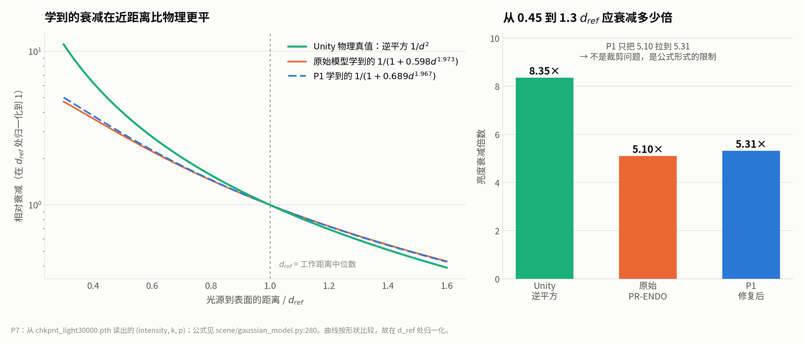

从 0.45 到 1.3 倍工作距离，Unity 的物理真值应该衰减 **8.35 倍**，原始模型只给 5.10 倍，
**P1 修复后也只有 5.31 倍**。

**结论：这不是幕布高斯造成的，是 `1/(1+k·d^p)` 这个函数形式本身的限制。**
这个公式在 d→0 时趋近常数 1，天然就不可能在近距离复现 1/d² 的陡峭程度。

这正好对应论文承认的 "challenges with very distant light sources"——我们把它量化了，
并且指出了具体原因在公式形式上。

#### (b) 高光（C5 / P2）

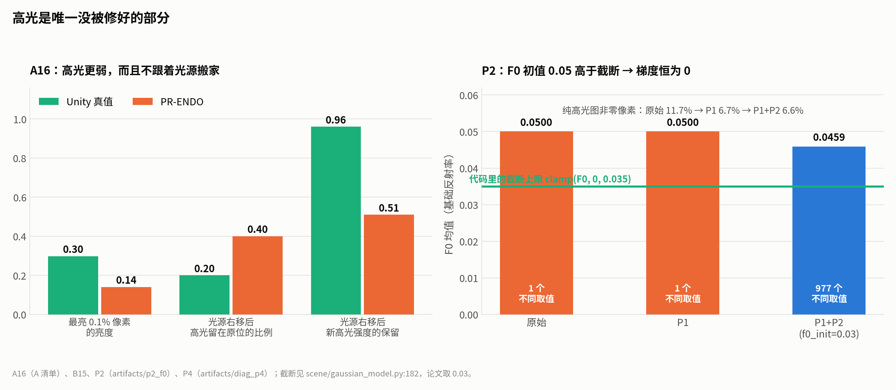

三个互相印证的发现：

1. **F0 从未被训练过。** 代码里 `torch.clamp(self.F_0, 0, 0.035)`（论文说 0.03），而默认初值
   `f0_init = 0.05` **高于截断上限**，所以梯度恒为 0——全场 213,091 个高斯的 F0 一模一样是 0.0500。
2. **粗糙度也是全场同一个值** 0.1227，对应的 GGX 高光瓣半高半宽只有 **0.55°**，而法线误差中位数是 **4.0°**。
   高光瓣比法线精度还细一个数量级，等于高光落点基本靠运气。
3. **高光不跟着光源搬家。** 光源右移 0.25 d_ref 后，Unity 的高光有 96% 的强度转移到新位置、
   只有 20% 留在原处；PR-ENDO 只转移 51%，却有 40% 留在原处——**说明一部分高光被烤进了基础色**。

我们试了 **P2：把 `f0_init` 改成 0.03 重训**。结果：F0 确实不再是常数了（977 个不同取值，std > 0），
**但高光没有变强**——纯高光图的最亮 0.1% 是 0.992，和基线 0.993、P1 0.997 基本一样，非零像素比例
反而从 11.7% 降到 6.6%。

**结论：F0 初值被截断只是表象，高光问题的根在粗糙度（全场共享）、法线精度（4°）或损失函数，
不在 F0 的初始化。** 这是一条明确的否定结论，比含糊的"高光还需要改进"有价值得多。

---

## 6. 结论

1. **PR-ENDO 可以迁移到 VR-Caps 数据，而且效果很好。** 这是第一个把 PR-ENDO 放到 C3VD / RotateColon
   之外的数据上、并且**带定量重光照真值**的评估。修复后重建 42.5 dB，L2 重光照 40.0 dB
   （距离模型自身的重建上限只有 2.5 dB）。

2. **我们补上了论文没做的那个基准。** 论文的重光照只有定性展示。我们用 611 条 (配置, 帧)、
   6 个难度层级、803 个 GT 比较，第一次给出了"PR-ENDO 的重光照在物理上有多准"的数字。

3. **最大的误差来源是一个工程缺陷，不是方法缺陷。** 继承自 3DGS 的 `z <= 0.2` 硬编码近裁剪在内镜
   近距离场景里剔除了 17.4% 的像素，占掉 79% 的重建误差。一行改动 + 重训 = **+8.0 dB**。
   **任何在内镜数据上用 3DGS 系方法的人都应该检查这一行。**

4. **剩下两个是真的方法局限。**
   - 衰减公式 `1/(1+k·d^p)` 在工作距离内偏平（5.3× vs 物理的 8.35×），修不掉，要改公式形式；
   - 高光偏弱且不随光源移动，根因在粗糙度/法线精度，不在 F0 初始化（P2 已证伪）。

5. **方法论上的收获**：先用"已排除"清单（13 项）把干扰因素清掉，再做归因，最后用重训实验
   把"配置问题"和"方法局限"分开。没有 L0 这一层做重建基线，上面任何一条都说不清楚。

### 还没做的

| 编号 | 内容 | 为什么重要 |
|---|---|---|
| P3 | 让 VR-Caps 导出带横向移动和转动的训练序列后重训 | 检验 C4/C20：直线轨迹让每点的入射角余弦只变化约 0.1，MLP 可能在"距离+方向"的新组合上外推失败 |
| P6 | 在 12 个留出视角上渲染重光照真值 | 现有重光照评估**全部在训练相机位置上**。这不影响已有结论的正确性，但限制了结论的适用范围 |
| — | L4 三个颜色配置有 0.8–1.0 dB 的低幅度残差（阈值 0.5 dB），ratio_bias ≈ 0 | 幅度小，已记录，未追查 |

**P6 这一条在演示时要主动说出来。** 如果有人问"你们的分数是不是高估了泛化能力"，
诚实的答案是：L0 的 12 个留出帧确实是未见视角（41.68 dB），但**重光照评估用的 49 个相机都是训练视角**。

---

## 7. 演示物料

### 7.1 图表清单

| 文件 | 内容 | 建议用在 |
|---|---|---|
| `fig01_two_routes.png` | 两条路线对比流程图 | 开场 |
| `fig12_near_cull_schematic.png` | 近裁剪在内镜几何里意味着什么 | 讲根因 |
| `fig02_p5_prune_timeline.png` | P5：近壁点在 4000 步被删 | 讲证据 |
| `fig16_psnr_vs_depth_band.png` | **误差跃变精确落在 0.2**（独立复算） | 讲证据，最强的一张 |
| `fig17_error_maps.png` | 误差图：误差全堆在近壁 | 讲证据 |
| `fig06_p4_render_depth_ratio.png` | P4：渲染深度 1.596 → 0.985 | 讲证据 |
| `fig03_level_psnr_baseline_vs_p1.png` | 6 个层级的增益 | 讲结果 |
| `fig04_near_vs_far_psnr.png` | 近壁/远区差距被抹平 | 讲结果 |
| `fig13 / fig14 / fig15` | 原始 / P1 / Unity 真值 三行图像对比 | 贯穿全场 |
| `fig05_attenuation_vs_inverse_square.png` | 衰减公式的固有局限 | 讲剩余局限 |
| `fig11_specular_and_f0.png` | 高光与 F0 截断 | 讲剩余局限 |
| `fig10_l2_direction_psnr.png` | L2 各方向，含"不重光照"基线 | 讲重光照的价值 |
| `fig07_L2_direction_effect_maps.png` | GT 上的 L2/L0 归一化亮度比图 | 解释方向差异 |
| `fig08 / fig09` | 旧模型 L2 五宫格、聚光指数标定拟合 | 备用 |
| `gifs/*.gif` | 8 个 P1 vs GT 的上下对比动图 | 现场循环播放 |

所有三行对比图的行序固定：**上 = 原始 PR-ENDO，中 = P1 修复后，下 = Unity 真值**。

### 7.2 两个 GUI 的演示方式

见 [`demo/DEMO_GUIDE.md`](demo/DEMO_GUIDE.md)。结论先说：**两个都录屏，现场放视频，不要现场跑。**
理由和备用方案在那份文档里。

---

## 8. 复现信息

| 项目 | 位置 |
|---|---|
| 数据集 | `PR-ENDO-data/VRCaps_lumen_100_v2/`（88 训练 / 12 测试） |
| 重光照真值 | `PR-ENDO-data/P1_611_eval/VRCaps_lumen_100_v2/relight/gt/` |
| 基线模型 | `Group-Project/prendo/runs/vrcaps_lumen_100_v2_r30k/`，213,091 高斯，33.64 dB |
| 基线预测 | `PR-ENDO/artifacts/pred_VRCaps_lumen_100_v2_20261112-0332/`（非 L2）、`..._20261113-0110/`（L2） |
| P1 预测 | `PR-ENDO-data/P1_download/{nonl2,l2}/` |
| P1 评估输出 | `Group-Project/prendo/runs/20261118-p1-p7/eval/VRCaps_lumen_100_v2/P1_611_fast/` |
| 评估代码 | `Group-Project/relight_eval/compare.py`、`relight_io.py` |
| 32 项归因实验 | `PR-ENDO/docling_PR-ENDO 重光照：实验清单与原因评估.md` |
| P1–P7 结果 | `Group-Project/prendo/runs/20261118-p1-p7/EVALUATION.md` |
| 官方代码 | SanoScience/PR-ENDO `ee53628`；子模块 `depth-diff-gaussian-rasterization` `8fa430b` |
| HPC | Imperial CX3，队列 `v1_gpu72`（L40S） |

**两点方法上的限制**（讲的时候如果被追问，直接说）：

1. 真值法线由平滑后的深度图求得，所有斜率类指标的**绝对值**会偏低——但 Unity 和 PR-ENDO 用的是
   同一套法线，所以**相对比较**仍然成立。
2. 归因阶段的 CPU 重写把高斯足迹近似成各向同性，只用于相对比较和归因，不用来报告绝对分数。
   P4 的 GPU 渲染后来验证了 CPU 的结论（1.7 倍 vs 实测 1.596 倍）。
